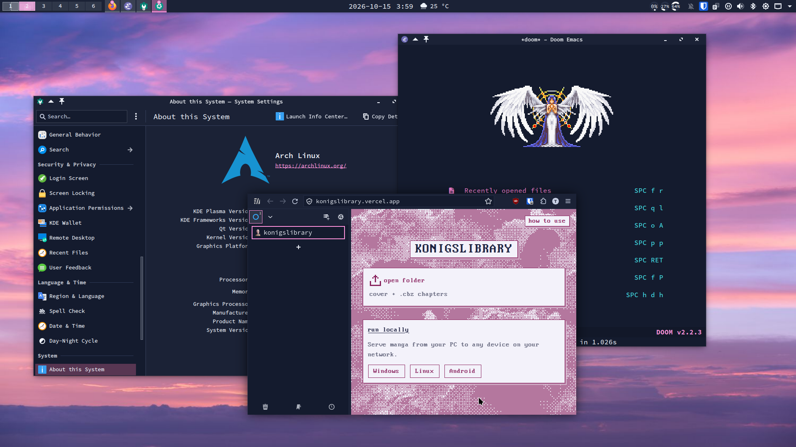
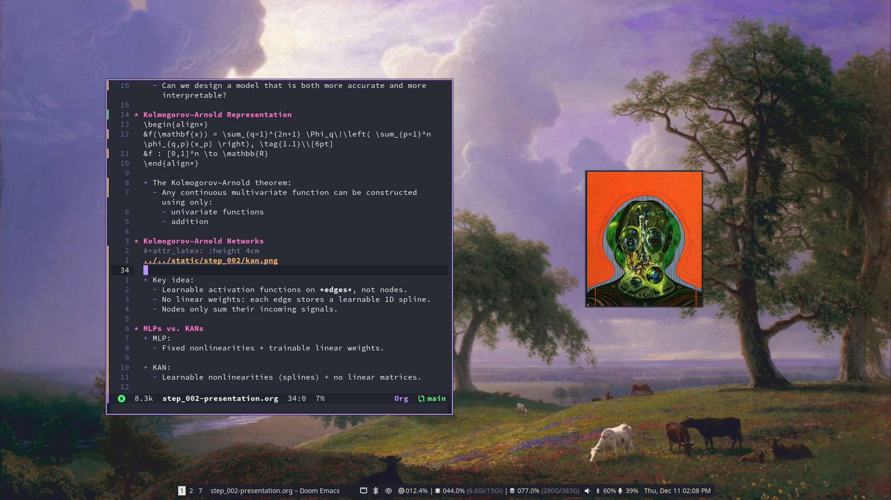
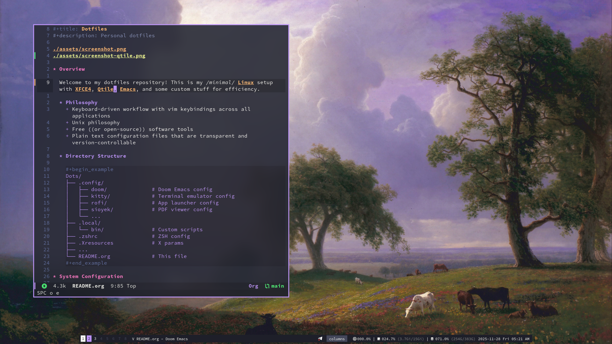

#+title: Dotfiles
#+description: Personal dotfiles

* Directory Structure

#+begin_example
Dots/
├── .config/
│   ├── doom/              # Doom Emacs config
│   ├── kitty/             # Terminal emulator config
│   ├── nvim/              # Neovim config
│   └── ...
├── .local/
│   ├── bin/               # Personal scripts
│   └── share/kwin/scripts/ # KWin scripts
├── legacy/                # Configs from previous setups (same layout as ~)
├── .zshrc                 # ZSH config
├── .Xresources            # X params
├── ...
└── README.org             # This file
#+end_example

* System Configuration

+ *GNU/Linux*: [[https://archlinux.org][Arch Linux]]
+ *Init System*: [[https://systemd.io/][systemd]]
+ *Package manager*: [[https://github.com/Morganamilo/paru][paru]]
+ *Desktop*: [[https://kde.org/plasma-desktop/][KDE Plasma]]
+ *Theme*: [[https://github.com/NasreddinHodja/laland][laland]] 

** Applications
+ *File manager*: [[https://apps.kde.org/dolphin/][Dolphin]] (or =dired=)
+ *Video player*: [[https://mpv.io/][mpv]]
+ *Image viewer*: [[https://apps.kde.org/gwenview/][Gwenview]]
+ *PDF viewer*: [[https://okular.kde.org/][Okular]]

** Dev Tools
+ *Primary Editor*: [[https://github.com/doomemacs/doomemacs][Doom Emacs]]
+ *WebDev Editor*: [[https://vscodium.com/][VSCodium]] with =vim= mode
+ *Terminal emulator*: [[https://sw.kovidgoyal.net/kitty/][kitty]] (sessions/tabs instead of tmux) with [[https://starship.rs/][starship]]
+ *Shell*: [[https://www.zsh.org/][zsh]] with vim mode, history substring search, and syntax highlighting

* Keyboard Layout [WIP]

+ [[https://github.com/foostan/crkbd][corne v2 42-key split keyboard]]
+ [[https://qmk.fm/][QMK firmware]]
+ [[https://github.com/NasreddinHodja/qmk_userspace][my qmk external userpace repo]]

* KDE
KWin scripts in =.local/share/kwin/scripts/= (=centercursoronfocus=, [[https://github.com/NasreddinHodja/quicktilegaps][quicktilegaps]]).

* Legacy
Configs from previous setups live in =legacy/=, mirroring the home layout (=legacy/.config/=, =legacy/.local/bin/=, =legacy/.config/systemd/user/=).
They aren't linked anywhere. Includes Hyprland, niri, mangowc, Qtile, XFCE, DankMaterialShell, quickshell, waybar, rofi, dunst/swaync, matugen, sioyek, zathura, yazi, zellij, tmux, alacritty, ghostty and more.

** Hyprland

** Qtile

** XFCE
[[./assets/screenshot-xfce.png]]

